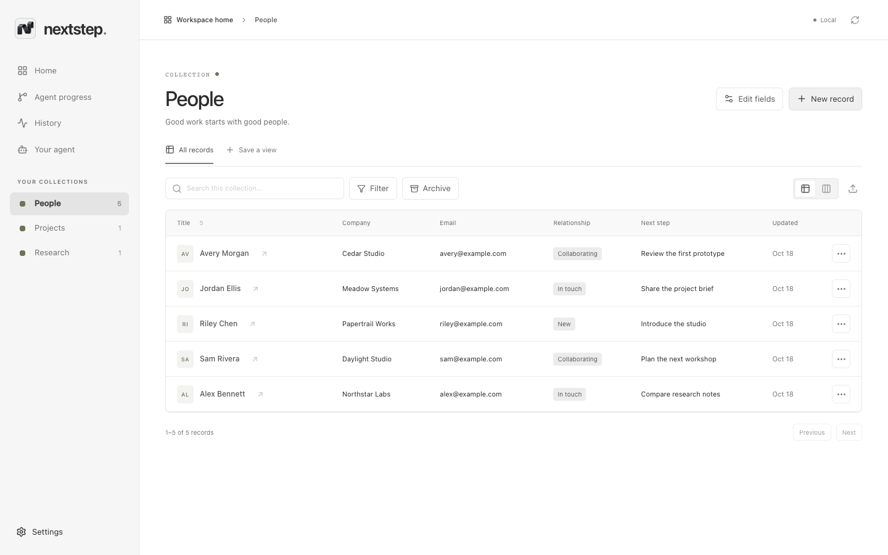
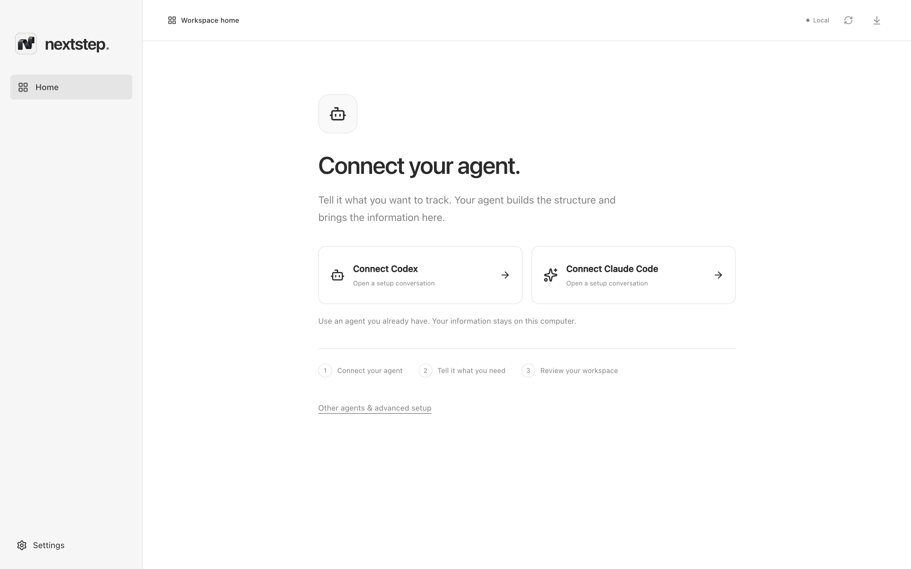
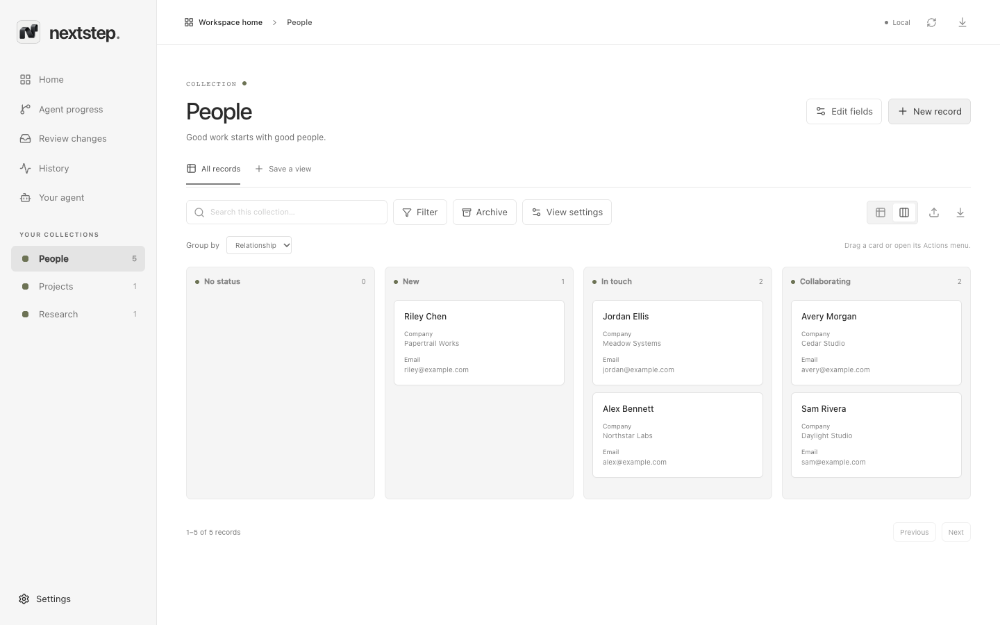
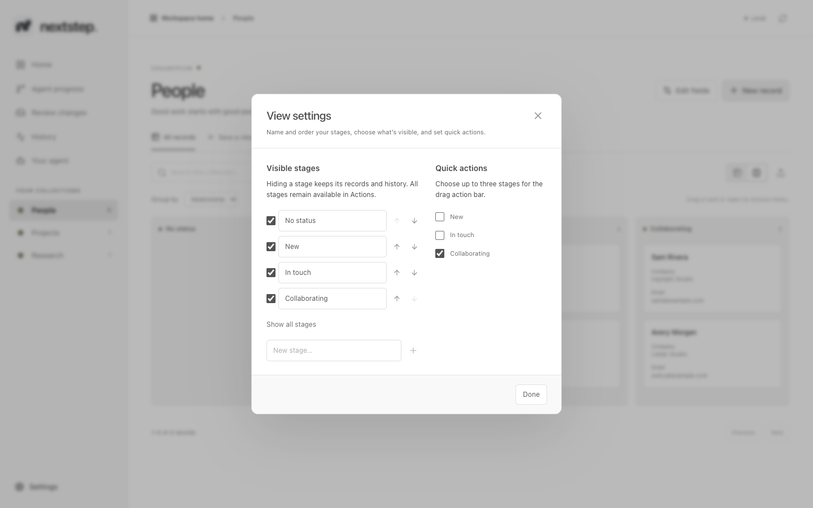
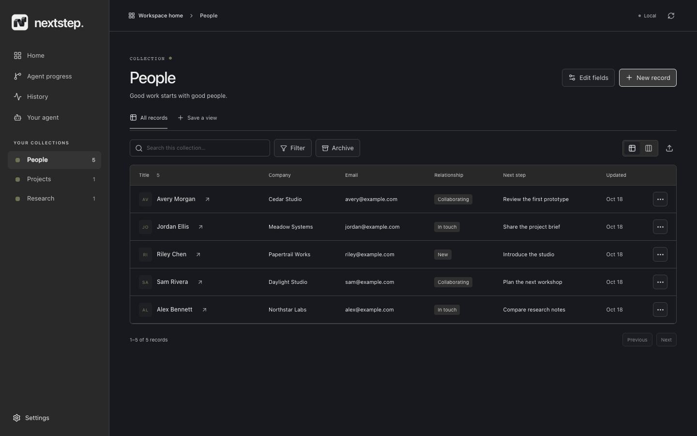
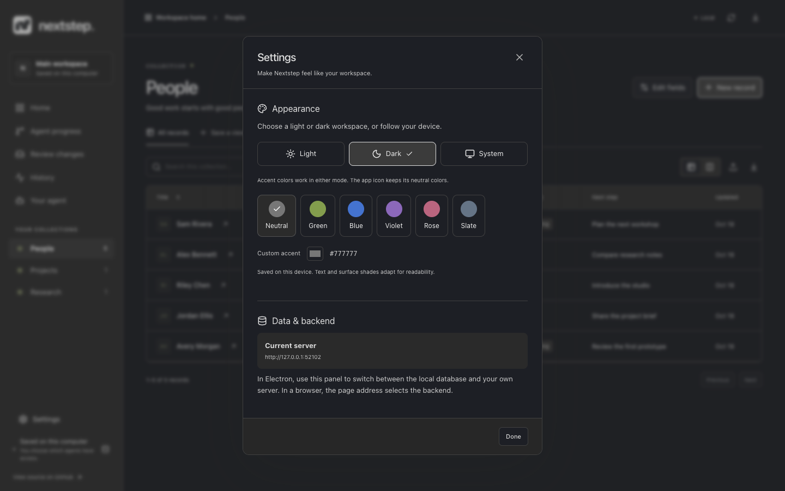

# Nextstep

**A CRM for your agent. A clear view for you.**

Tell your agent what you need to keep track of. It builds the collections, fields and views, sources information with its own tools, and keeps your records up to date. You follow its progress in Nextstep, with review available when you want it.

Nextstep is a local-first **Electron app** with a SQLite database on your computer. It is open source, works with your own agent, and can connect to a [backend on your own server](docs/self-hosting.md). No Nextstep account, model subscription or API key is required.

**[Download for macOS · Apple silicon](https://github.com/martinrajdl/nextstep/releases/download/v0.4.10/Nextstep-0.4.10-macOS-arm64.zip)** · [Website](https://www.nextstepcrm.com/) · [All releases](https://github.com/martinrajdl/nextstep/releases)



*Documentation screenshots use a separate, fictional database. New installations start empty.*

## Get started

1. **Open Nextstep.** Unzip the download and move Nextstep.app into Applications. The Apple silicon build is signed with Developer ID and notarized by Apple; no developer tools are needed.
2. **Connect your agent.** Choose Codex or Claude Code. Nextstep adds its connection and opens a new local conversation with a prepared request. Review the request and send it in your agent.
3. **Describe what you need.** Your agent asks about your work and creates the structure and information. You do not need to design a database or enter records first.
4. **Follow the work.** The new collection opens with its fields, records and views ready to use. Keep giving direction in your agent. Turn on **Settings → Agent changes → Require review** if you prefer to approve changes first.

For example: “Help me keep track of potential collaborators, what they do, and our next conversation.”



Automatic connection is available for installed Mac desktop agents. The **Agent** page brings progress together with an optional **Connection & instructions** panel. **Other agents & advanced setup** exposes the exact MCP configuration and setup request for other clients, browser use or self-hosting. The app never sends a message automatically. When review is enabled, the agent must read the outcome to continue; Nextstep does not run or schedule agents itself.

## What your agent can build

- **Collections for your work:** contacts, projects, research, deals or another structure. Typed fields include text, numbers, dates, email, URLs, checkboxes, selections and relationships.
- **Useful views:** tables and boards, search, filters, sorting and saved views. Rename and reorder board stages, hide what you do not need, and move cards with Actions or drag-and-drop. Agents discover the schema and views through MCP.
- **Direct writes, optional review:** agents save changes by default. Enable Require review in Settings to receive proposals instead. Proposals show before and after values; stale proposals cannot overwrite newer decisions.
- **Visible progress:** see the agent’s reports, sources and pending work alongside confirmed applied changes. Records keep their history and can be archived and restored.
- **Your appearance:** light, dark or system mode, with a neutral default and optional color accents. Choose in Settings or the native View → Appearance menu. The app icon stays unchanged.
- **Your data:** local SQLite, JSON exports in Settings → Data & backend, and private self-hosting. No built-in model. Optional anonymous usage counts are off by default.

<details>
<summary>Pipeline stages, dark mode and appearance settings</summary>









</details>

[Read the composable CRM guide](docs/composable-crm.md) for supported operations, MCP tools, review policy and the data model. Manual schema and JSON tools remain available under advanced setup and Manual tools.

Signed macOS releases from 0.4.3 include **Settings → App updates**: check for updates, download a signed release, then restart to install it. Update checks can be disabled independently of optional usage counts.

## Run from source

Use **Node.js 24** and **pnpm 11.19.0**:

```sh
git clone https://github.com/martinrajdl/nextstep.git
cd nextstep
pnpm install --frozen-lockfile
pnpm exec install-electron
pnpm build
pnpm desktop
```

The desktop app includes its own runtime when packaged. **File → Open database…** opens an existing Nextstep database in place. A missing previously selected database is an error; it is never silently replaced. See [desktop.md](docs/desktop.md) for paths, backups and packaging, and [macos-signing.md](docs/macos-signing.md) for signed releases.

To run the browser interface and backend from this checkout:

```sh
pnpm run setup             # Non-destructive initialization of data/nextstep.sqlite
pnpm build
pnpm background:start      # http://127.0.0.1:4317
pnpm background:status
pnpm background:stop
```

The workspace is at `/`. The browser version offers copyable agent configuration. `pnpm start` runs the server in the foreground. For a backend on another machine, follow [self-hosting.md](docs/self-hosting.md) and connect through Settings in Electron.

## Data and privacy

**Settings → Privacy → Share anonymous usage** is off by default. If enabled, the desktop app sends one daily check-in with a rotating daily identifier, app version and OS family. CRM data and agent content are never part of the check-in. Private receipts are scheduled for deletion after a 31-day window; download totals use GitHub's release counters. [Read the exact payload and privacy details](docs/privacy.md).

Nextstep binds its HTTP service to loopback with Host/Origin checks. It is a single-owner app, not a public multi-user server. Use a private SSH tunnel for self-hosting; do not expose the unauthenticated port to the internet. The desktop renderer stays local and sandboxed when using your backend.

Your chosen agent provider may process the context it reads. The general CRM connection can read and write by default. **Require review** is off by default and applies to the selected database, including already-connected agents. Explicit proposals always wait for a human decision.

Personal records, research and profiles belong in ignored `data/`; runtime logs belong in `.runtime/`. Tests and screenshots use temporary databases. For a full backup while running, use SQLite's backup operation. Otherwise stop the app and all connected helpers before copying the database and any `-wal` / `-shm` companions together. JSON export is not a full SQLite backup.

| Setting | Purpose |
| --- | --- |
| `NEXTSTEP_DB_PATH` | Absolute database path shared by the source server, CLI and MCP helpers. Defaults to `data/nextstep.sqlite` in the checkout. |
| `DB_PATH` | Legacy alias, used only if `NEXTSTEP_DB_PATH` is unset. |
| `PORT` | Source production port, default `4317`. |
| `PLAYWRIGHT_CHANNEL` | Set to `chrome` to test with installed Chrome instead of bundled Chromium. |
| `NEXTSTEP_DISABLE_UPDATES` | Set to `1` to disable desktop update checks. |
| `NEXTSTEP_DISABLE_USAGE` | Set to `1` to disable optional desktop usage reporting regardless of its saved preference. |

The scripts read the process environment; `.env` files are not loaded automatically. The public website lives in its own [repository](https://github.com/martinrajdl/nextstep-website).

## Development

```sh
pnpm dev                   # UI 4317, API 4318; stop any server using those ports first
pnpm test                  # Isolated store, migration, import, HTTP and MCP checks
pnpm lint
pnpm build
pnpm exec playwright install chromium
pnpm test:e2e              # Isolated database on port 4321
pnpm test:desktop          # Electron, agent handoff, review flow, appearance and backend
node scripts/capture-screenshots.mjs  # Fictional documentation screenshots
```

Node 22.13+ supports the SQLite runtime; Node 24 is recommended and used in CI. Dependencies are pinned. Tests never seed the selected user database. For contributor guidance, see [CONTRIBUTING.md](CONTRIBUTING.md) and [AGENTS.md](AGENTS.md).

The interface uses shared shadcn components in `components/ui/` for controls, dialogs, menus, tooltips, tables and navigation. `app/theme.css` owns the light and dark semantic color tokens. Dark mode pairs a near-black canvas with slate surfaces; accent preferences affect actions without tinting the workspace. Domain layouts use these same tokens, and `app/focus.css` provides the shared keyboard focus treatment.

## License

[MIT](LICENSE). React, TypeScript, Vite, SQLite and Electron. See [third-party notices](THIRD_PARTY_NOTICES.md).
