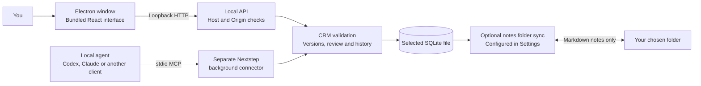
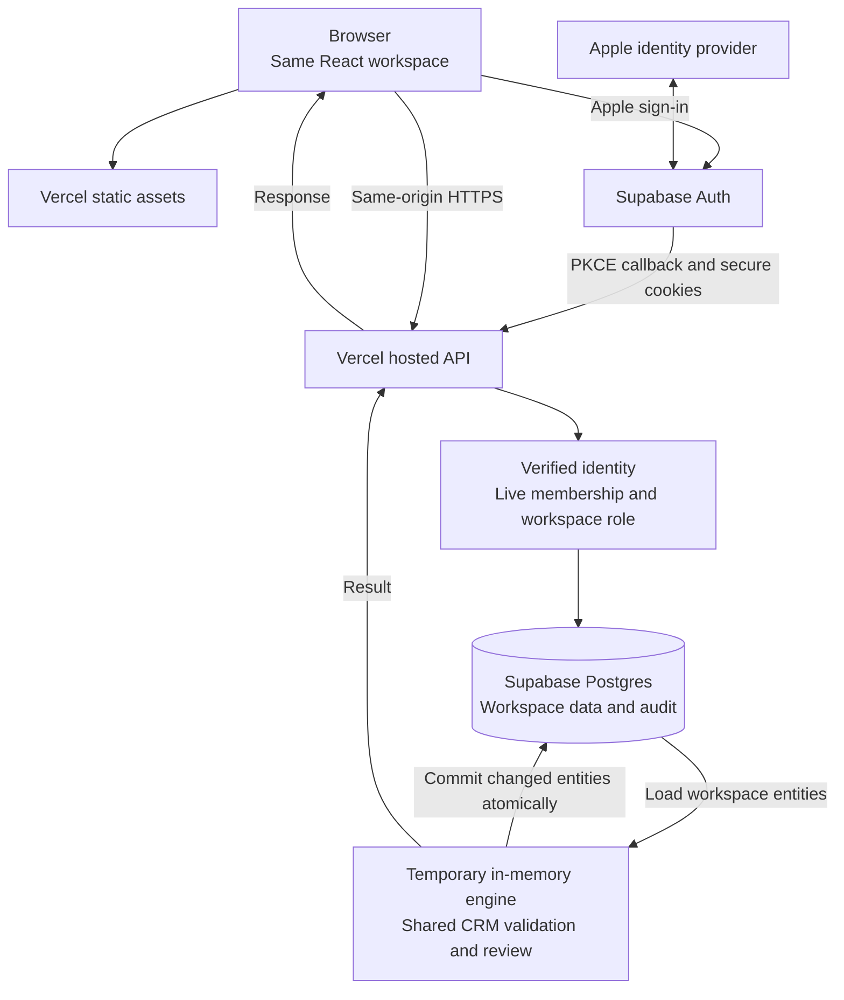
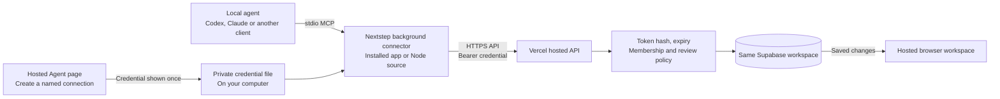

# Nextstep architecture

Nextstep has two storage modes. The desktop app normally keeps its selected SQLite database on the computer. The optional hosted app keeps its shared workspace in Supabase Postgres. Both use the same interface and validation rules. Agents run in their own clients; Nextstep does not run a model or schedule their work.

## Local desktop

The desktop process and MCP helpers share the same selected database file. Helpers also work when the desktop window is closed. Records, notes, proposals and history stay in SQLite; appearance and connection preferences live separately. Folder sync is optional, local-desktop only, and covers notes rather than the whole CRM.

For a private server, the desktop still serves its own bundled interface. It proxies requests through a loopback SSH tunnel to the private server's API and SQLite database. It opens no local shadow database. This private-server mode is separate from the authenticated Vercel/Supabase deployment.

## Hosted shared workspace

Supabase Postgres is the durable source for hosted records, notes, proposals, history and progress reports. Each operation uses a disposable in-memory SQLite engine to apply the same rules as the local app. It does not create a filesystem database on Vercel. Workspace locks, optimistic versions and a single Postgres transaction protect writes.

Invited membership and workspace roles are checked before data access. The restricted runtime role is subject to row-level security. Browser sessions use secure HttpOnly cookies. Folder-sync paths and desktop preferences are not shared entities. The browser periodically refreshes committed changes; this adapter does not use Supabase Realtime subscriptions.

## Local agents working with hosted data

Create a connection in **Agent → Connection & instructions**, save its credential in an owner-only file, and add the generated `nextstep-shared` entry to the local agent's MCP settings. Nextstep 0.5.2 or newer provides this connector from the installed macOS app; a Node 24 source checkout is another option.

The connector exposes the same CRM and notes tools as the local connection. It calls authenticated HTTPS endpoints rather than reading the computer's SQLite file. It needs no Supabase password or Apple browser session. Credentials expire after 90 days, can be revoked, and lose access when membership is removed. Require review is enforced by the server; an agent cannot approve its own proposal or change the review policy.

This is stdio MCP bridged to an HTTPS API, rather than a remote Streamable HTTP MCP endpoint. Custom clients can call the same API with the agent credential. A failed hosted connection returns an error and never falls back to local storage.

## Boundaries

| Concern | Local desktop | Hosted workspace |
| --- | --- | --- |
| Durable CRM and notes | Selected SQLite file | Supabase Postgres |
| Human interface | Bundled Electron renderer | Browser assets from Vercel |
| Agent transport | stdio MCP to the selected file | stdio MCP bridge to authenticated HTTPS |
| Human access | Operating-system account | Invited Apple sign-in and workspace role |
| Agent access | Local process and explicit database path | Hashed, expiring workspace credential |
| Optional review | Enforced inside SQLite writes | Enforced before the Postgres commit |
| Notes folder sync | Optional, in Settings | Hidden; notes already use shared storage |
| Local/hosted synchronization | No automatic synchronization | No automatic synchronization |

Local and hosted databases are separate authorities. A selected one-time transfer can preserve records, notes and history; it does not establish bidirectional synchronization. Keep each agent connection aimed at the intended workspace.

Source entry points: `desktop/main.mjs`, `app/workspace.tsx`, `server/http.mjs`, `server/crm-store.mjs`, `mcp/crm-server.mjs`, `mcp/remote-options.mjs`, `mcp/remote-crm.mjs` and `server/hosted/`. See [self-hosting](self-hosting.md) for deployment and agent configuration, and [the CRM contract](composable-crm.md) for operations and data limits.
